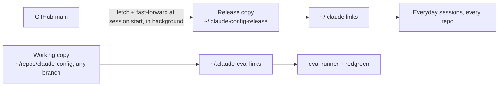

# Release Config Split — Design

**Status:** Shipped (PR #587, 2026-11-05). Follow-ups in #588.

## What this is and why it matters

claude-config installs your standards (rules, skills, agents, commands, hooks,
and `CLAUDE.md`) by symlinking them from `~/.claude` into this repo's working
copy. Every Claude Code session on the machine reads whatever that working copy
holds when the session starts.

So the working copy's git state *is* your global config:

- **On a feature branch:** every session in every repo runs the branch's
  unmerged rules.
- **Behind `main`:** PRs merge on GitHub, but sessions don't see them until
  someone pulls.
- **During a `redgreen` run:** the stripped rule is live for all sessions,
  not just the eval (`bin/redgreen.fish` says so in its header).

This already caused a real miss. On 2026-10-27, a job-seeker session opened a
PR without the AS A / I WANT TO / SO THAT story format. That rule (#551) had
merged on GitHub the day before. But the working copy was on
`feature/pr-validation-skip-regex`, based on `b925fa4`, which predates #551.
The transcript has zero mentions of the rule.

The working copy left `main` 12 times between 2026-09-30 and 2026-10-30.

## Goals

1. Everyday sessions in any repo run only rules merged to GitHub `main`.
2. A merge on GitHub reaches everyday sessions with no manual step.
3. Eval runs (`tests/eval-runner-v2.ts`, `bin/redgreen.fish`) keep testing the
   *branch* in the working copy, including unmerged rule edits.
4. Nothing an eval does (stripping a rule, a half-done branch) reaches
   everyday sessions.
5. You can tell which claude-config commit a given session loaded.

## Non-goals

- Changing which skills and agents are pruned (`bin/lib/symlinks.fish`,
  `pruned_skills` / `pruned_agents`). The pruned list stays as it is.
- Fixing the "doesn't always ask for the problem" report. Goal 5 makes it
  testable later; diagnosing it is separate work.
- Sharing a stable config across machines. This is one Mac.

## Anti-goals (a failure even if it technically works)

- **Evals silently test the release copy instead of the branch.** RED/GREEN
  results would look valid and mean nothing. This is worse than today.
- **A manual "deploy" or "pull" step after merging.** That moves the drift
  instead of removing it.
- **Slower session start.** No network wait on the startup path.
- **More per-prompt context.** The rules-reduction work (#554, #564) cut
  thousands of tokens. Don't add a line to every session's context for this.

## Facts verified on 2026-11-05

| Question | Result | How |
|---|---|---|
| Can a separate `CLAUDE_CONFIG_DIR` use the subscription login? | Yes, after a one-time `claude auth login` in that folder. Before login it fails with `Not logged in`. | `env -u ANTHROPIC_API_KEY CLAUDE_CONFIG_DIR=$HOME/.claude-eval claude auth status` → `"authMethod": "claude.ai"` |
| Does a `SessionStart` hook run before rules are read? | No. Rules are read first. A startup update reaches the *next* session. | Probe rule `OLD-OTTER`; startup hook rewrote it to `NEW-HERON`. Run 1 answered `OLD-OTTER`, run 2 answered `NEW-HERON`. |
| Does `ANTHROPIC_API_KEY` in the shell override the login? | Yes. `auth status` shows `api_key` unless the variable is unset. | Same command without `env -u` |

`~/.claude-eval` already exists and is logged in. It holds only Claude Code's
own files and a `settings.json` with `"theme": "dark"`.

## The design (decided)

### 1. Release copy

- A git worktree of this repo at `~/.claude-config-release`, checked out
  **detached** at `origin/main`. A detached checkout can't be confused with a
  branch you're working on, and it blocks accidental commits there.
- `bin/link-config.fish` points `~/.claude` links at the release copy instead
  of the working copy. The link layout (`bin/lib/symlinks.fish`) is unchanged.
  Only the source root changes.

### 2. Automatic update

- A new `SessionStart` hook in `hooks/` fetches `origin main` and fast-forwards
  the release copy.
- It runs **in the background** and exits right away. Because rules load
  before the hook runs, waiting would not help the current session anyway.
  The accepted cost: after a merge, the first new session still has the old
  rules, and the next one has the new ones.
- It is registered in the global `~/.claude/settings.json`, not only in
  `.claude-plugin/hooks.json`. The plugin cache is a frozen copy and would
  never pick up hook changes.
- Safety: if the release copy has local changes, or the update can't
  fast-forward, it changes nothing and logs why. It never resets, stashes, or
  deletes.
- **Added, removed, or renamed files** *(my call)*. A fast-forward alone only
  updates files that are already linked. When the update changes the set of
  managed files, the hook also runs `link-config.fish` in its default mode.
  That mode is safe to re-run, prunes orphan links, and refuses to replace real
  files (`--install` would back them up and replace them, which is too much for
  an unattended run). It touches only links whose
  target changed, so it doesn't swap out files a running session is reading.
- **Accepted limit:** hook *registrations* in `~/.claude/settings.json` are not
  in the repo, so a merge that needs a new registration still needs a manual
  step. The hook logs a warning when `link-config` reports one is needed. Today
  that covers the `execution-mode.md` gate hook.
- **Eval sessions don't run the updater** *(my call)*. It is the one stated
  exception to eval parity (section 3). Otherwise every eval turn would fetch
  into the shared `.git` and add noise to the goal-5 log.

### 3. Eval config folder

- `~/.claude-eval` gets the same link layout as `~/.claude`, pointed at the
  **working copy** (the branch).
- Eval sessions must otherwise match production: same plugins, MCP servers,
  and settings. Today evals inherit all of these from `~/.claude`. Losing them
  (for example the superpowers plugin) would change eval behavior.
- Hooks in eval sessions must run the **branch's** hook scripts. Global
  `settings.json` has hard-coded `~/.claude/hooks/...` paths, so a plain copy
  of it would run the release copy's hooks.
- `tests/eval-runner-v2.ts` spawns `claude` with
  `CLAUDE_CONFIG_DIR=$HOME/.claude-eval`.
- `bin/redgreen.fish` repoints `~/.claude-eval/rules/<rule>.md` instead of
  `~/.claude/rules/<rule>.md`, and runs its suite against `~/.claude-eval`.
  Update its header comment, which today warns that stripping affects all
  sessions.
- **Missing eval folder** *(my call)*. The runner and `redgreen` fail with a
  clear error if `~/.claude-eval` is missing or not linked. They never fall back
  to `~/.claude`, because that is the silent-wrong-copy anti-goal. CI
  (`behavioral-evals.yml`) authenticates with `CLAUDE_CODE_OAUTH_TOKEN` and
  doesn't use the `~/.claude` link layout today. It opts out with an explicit
  environment variable set in the workflow, never by default.
- **Interactive branch sessions.** Everyday sessions *inside* this repo also get
  release rules. You chose this: branch rules are tested only through evals
  until merged. To try a branch interactively, run
  `env CLAUDE_CONFIG_DIR=$HOME/.claude-eval claude`. Setup docs say so.
  The repo's vendored `.claude/skills/*` still load as project skills here, next
  to the release copies in `~/.claude/skills`. That overlap exists today. The
  builder confirms which copy wins and documents it.
- The eval login is a one-time manual step, already done on this machine.
  Setup docs say how to redo it (`claude auth login` with `CLAUDE_CONFIG_DIR`
  set) if it expires.

### 4. Which commit a session loaded

- The startup hook appends one line per session to a log file: timestamp,
  session ID, the release copy's commit **before** the update (what this
  session loaded), and the result of the update.
- Nothing is added to session context (see Anti-goals).

## Constraints

- **Language:** match what's there: fish for `bin/`, bash for `hooks/`
  (shellcheck must pass with CI's 0.8.0, so avoid `A && B || C`), TypeScript
  for `tests/`.
- **Tests:** follow the existing patterns in `tests/symlinks-test.fish`,
  `tests/link-config.test.ts`, and `tests/hooks/`. Write a failing test before
  each behavior change.
- **`validate.fish`** and `bin/verify-rule-loaded.fish` must keep passing
  *(my calls)*:
  - `link-config.fish` uses the release copy as its source root when it
    exists, and the current checkout otherwise. CI has no release copy, so CI
    behavior doesn't change.
  - Phase 1e checks `~/.claude` against whichever source root `link-config`
    uses, so links don't all show as STALE locally.
  - `verify-rule-loaded.fish` targets the eval folder. Its job is checking a
    new rule *before* merge, which only the eval folder can see.
- **Setup:** `install.fish` / `bin/first-run.fish` must be able to create the
  release copy and the eval folder on a fresh machine, and must be safe to
  re-run.
- **Undo:** `bin/link-config.fish` pointed back at the working copy must restore
  today's behavior.

## Left to the builder

- The exact log file path and line format for goal 5.
- How eval-runner and redgreen learn the eval folder path (a constant, an
  environment variable, or a shared helper).
- How the eval folder gets plugins and settings parity with production while
  running branch hooks (symlinks, a generated `settings.json`, or another
  approach). The requirement is in section 3. The mechanism is open.
- Whether `link-config.fish` gains a flag for the source root and target home,
  or a separate entry point manages the eval folder.
- Network timeouts and how the background update is detached.

## How we'll know it worked

- With the working copy on a branch that edits a rule, a new session in another
  repo shows the `main` version of that rule. An eval run shows the branch
  version.
- After a PR merges on GitHub, the second new session sees the change with no
  manual step.
- An interrupted `redgreen` run leaves `~/.claude/rules` untouched.
- The log shows which commit each session loaded.
